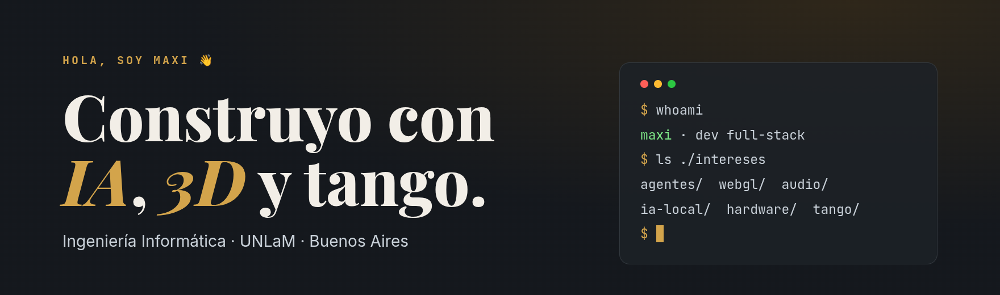
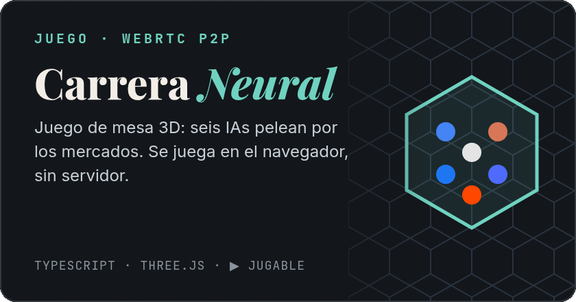
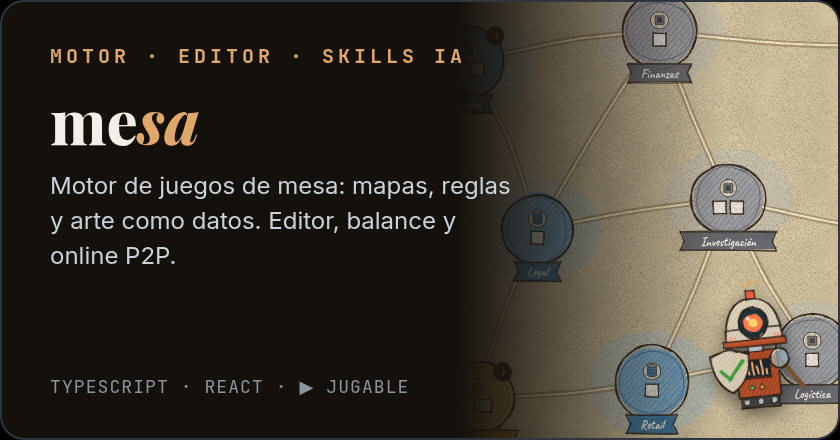
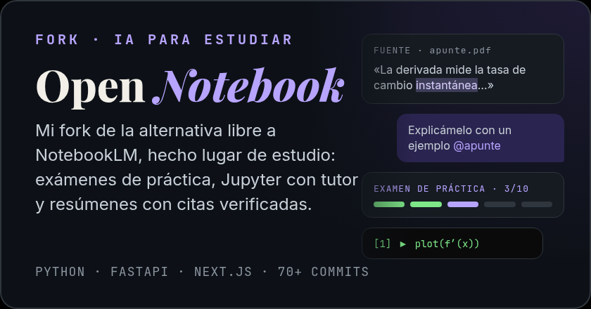
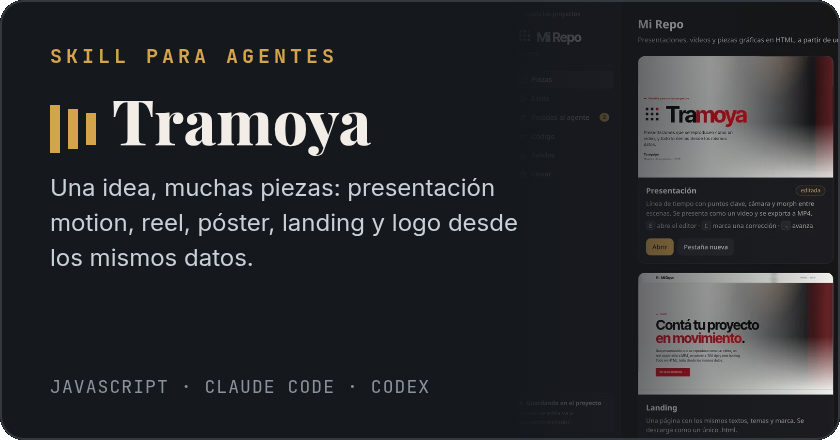
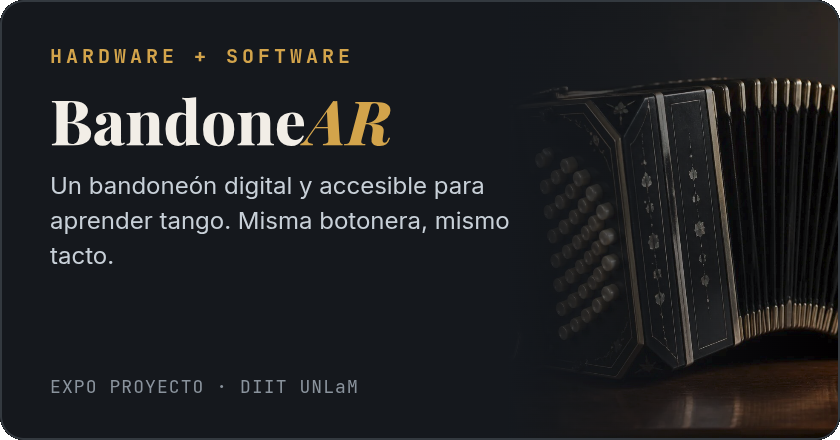
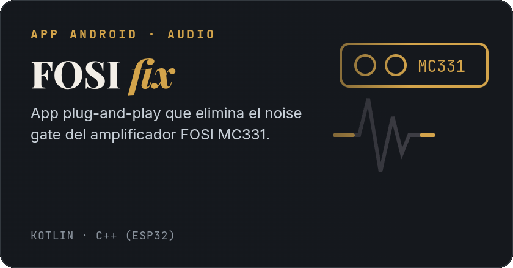
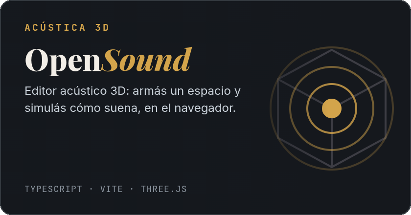
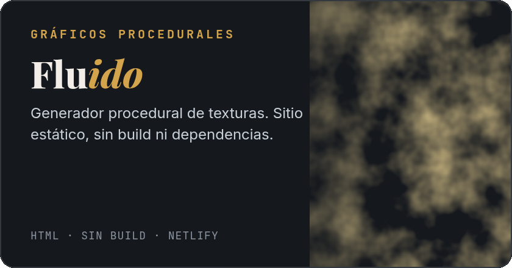
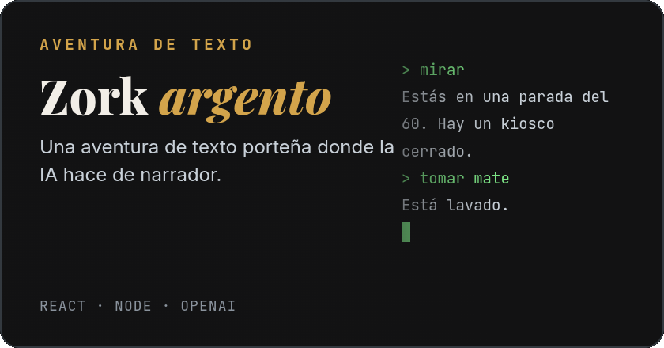

Estudio **Ingeniería Informática en la UNLaM** y me gusta armar cosas que mezclan código con algo físico o artístico: juegos 3D en el navegador, herramientas para agentes de IA, audio y hasta un bandoneón.

- 🎲 Ahora: **[Carrera Neural](https://caseresmaxi.github.io/carrera-neural/)**, un juego de mesa 3D multijugador por P2P. [Jugalo acá](https://caseresmaxi.github.io/carrera-neural/).
- 🧩 Y lo convertí en **[mesa](https://github.com/CaseresMaxi/mesa)**, un motor de juegos de mesa donde el mapa, las reglas y el arte son datos. Trae un editor, un simulador de balance, skills para que Claude diseñe juegos y online P2P. [Probalo acá](https://caseresmaxi.github.io/mesa/).
- 📚 Llevo **[mi fork de Open Notebook](https://github.com/CaseresMaxi/open-notebook)**, la alternativa libre a NotebookLM, hacia una herramienta para estudiar: exámenes de práctica, cuadernos Jupyter con un tutor al lado de cada celda, resúmenes con citas verificadas de la fuente y un servidor casero con Tailscale.
- 🎭 Hago **[Tramoya](https://github.com/CaseresMaxi/tramoya)**, una skill que le permite a un agente generar presentaciones, reels y pósters.
- 🧠 Me interesa la IA que corre **local**, sin nube ni API.
- 🪗 Y el tango: con **BandoneAR** buscamos que aprender bandoneón sea accesible.

## Proyectos

 

 

 

 

<b>En el taller</b> (proyectos que todavía no publiqué)

| | |
|---|---|
| **inmo3d** | Recorridos 3D de propiedades a partir de fotos, videos y planos (Blender → GLB → web). |
| **Corrector local** | Corrige ortografía en cualquier app con <kbd>Meta</kbd>+<kbd>Shift</kbd>+<kbd>C</kbd>, con un LLM en la GPU. |
| **Laya browser demo** | Un agente que maneja el navegador con un modelo "Sistema 1" local, sin un LLM decidiendo cada clic. |
| **Tango Restore Lab** | Restauración de discos de 78 rpm: declick, denoise y súper-resolución con AudioSR. |
| **3D Builder 4 Dummys** | Le pasás idea, medidas y fotos a una IA, que arma la pieza; vos la ajustás y exportás el STL. |
| **Cuerda** | Estudio de guitarra web con detección de tono por micrófono. |

## Con qué trabajo

